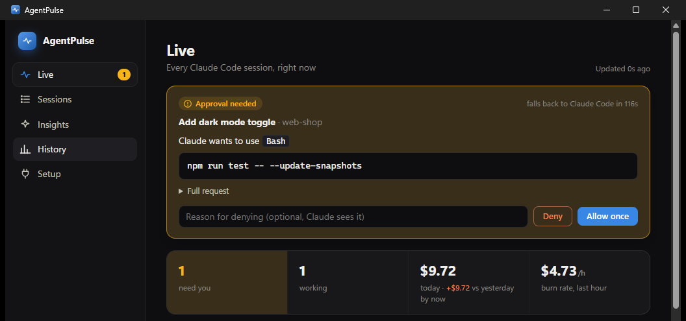
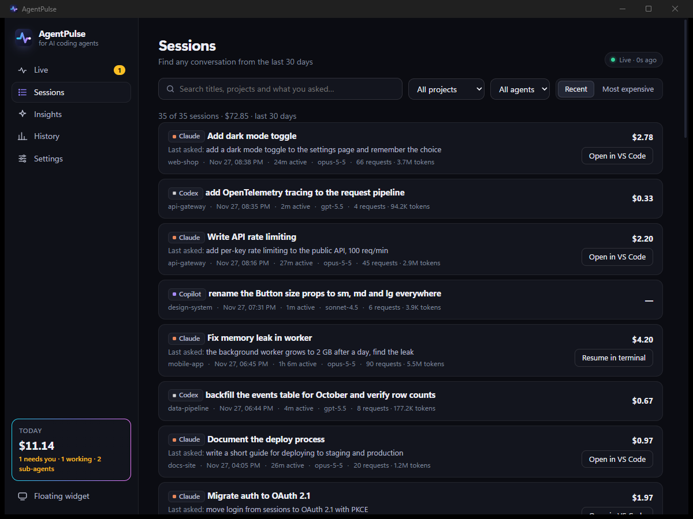
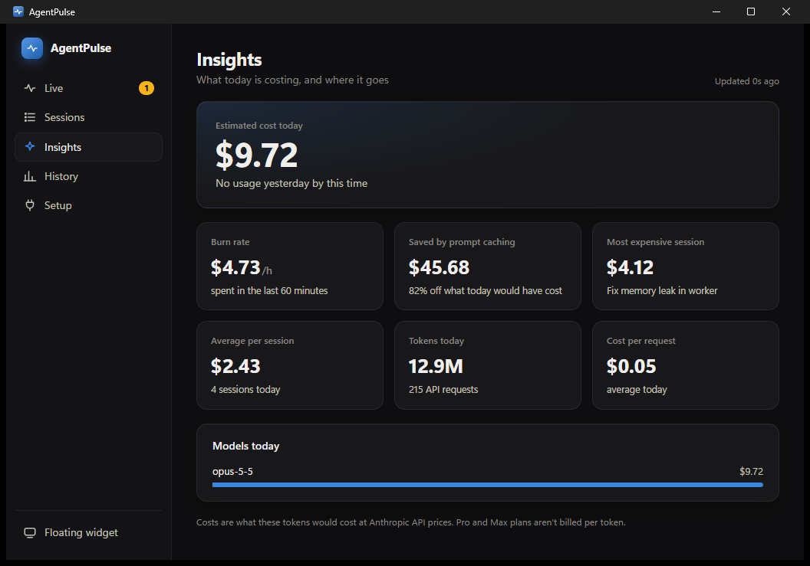
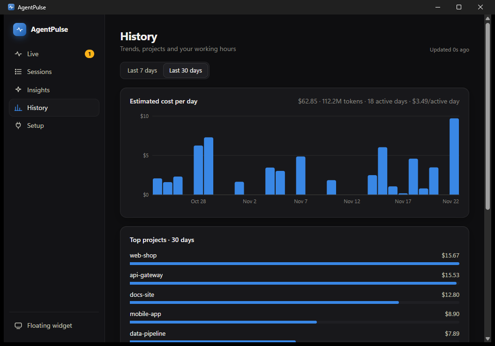
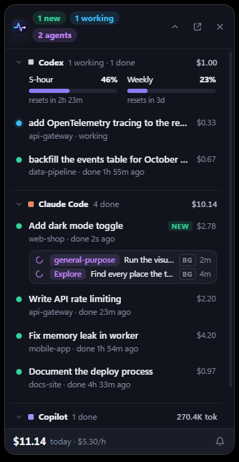

# AgentPulse

**Mission control for your AI coding agents.**

Running Claude Code in three terminals, Codex in a fourth, and a pile of sub-agents in the background? AgentPulse shows every session and sub-agent on one screen: which ones are working, which one is stuck waiting for your approval, and what each is costing. It chimes and notifies you the moment a task finishes or needs you, and shows trends your editor can't. Everything stays on your computer.

> **Status:** early. Windows only for now. Per-user installer (no admin needed) with signed in-app updates from GitHub Releases. Works with **Claude Code** (full support), **GitHub Copilot CLI** and **OpenAI Codex CLI**.



| Sessions | Insights | History | Floating widget |
|---|---|---|---|
|  |  |  |  |

<sub>Screenshots use generated demo data (`scripts/demo-logs.mjs`), not real sessions.</sub>

---

## 1. What it does

| Page | What you get |
|---|---|
| **Live** | A card per agent session across all projects and terminals (Claude Code, Codex, Copilot CLI): *Working*, *Needs you* (with the permission question), *Done*, or *Idle*, with its title, project, model and cost so far. |
| **Sub-agents** | See the helpers each session started (Claude Code's Task/Agent tool, Copilot subagents): what each was asked to do, whether it runs in the background, and whether it's still running or finished. Background agents keep showing as running even after the main session's turn is over. |
| **Plan usage** | Bars for how much of your plan you've used, with the reset time. **Claude Code**: your real 5-hour and weekly usage (and spend limit, if your plan has one), saved from what Claude Code hands its status line (Pro/Max plans; needs *Connect hooks*). **Codex**: real 5-hour and weekly usage from its logs. **Copilot**: an estimate of this month's AI credits from this computer's Copilot CLI logs, against the plan you pick in Settings. |
| **Open** | Jump straight to a session: VS Code sessions focus their VS Code window; finished terminal sessions reopen in a new terminal with `claude --resume`. |
| **Approve in AgentPulse** | Optional. When Claude Code asks permission to run a command or edit a file, the request appears at the top of the Live board with the **full command**, a countdown, and **Allow once** / **Deny** (with a reason Claude sees). No answer in time, or AgentPulse not running, and Claude Code shows its normal prompt. Nothing is ever auto-approved. |
| **Quick reply** | Type a follow-up on any finished session and send it without leaving AgentPulse. It runs in the background on the session's own model, streams the answer into the card, and you choose the permissions: *Ask first*, *Allow edits*, or *Plan only*. |
| **Sessions** | Every session from the last 30 days, from every agent, in one searchable list: search titles, projects and **what you last asked**, filter by project or agent, sort by recent or most expensive, then open or resume Claude Code sessions. |
| **Insights** | Today's cost vs. yesterday at the same time, burn rate ($/hour right now), money saved by prompt caching, most expensive session, average per session and per request, cost by model and by agent. |
| **History** | 7 or 30-day cost chart, top projects, and a weekday × hour heatmap of when you actually work with your agents. |
| **Settings** | Which agents were found on this computer, one-click **Connect hooks** for Claude Code (backs up your settings first, touches only AgentPulse's own entries), **Alert sound**, approvals, phone notifications, **Start with Windows**, and **Updates**. |
| **Floating widget** | An always-on-top companion for a second monitor: sessions **grouped by agent** (collapsible, with each agent's state counts and spend today), running sub-agents, **Allow once / Deny** for approvals right in the widget, Codex plan usage inside its group, today's cost, a green "new" marker on finished sessions you haven't checked yet, and a bell to mute alert sounds. Click a session to jump to its project in VS Code. It sizes itself to its content, collapses to a single strip, and remembers where you put it. |
| **Tray icon** | The AgentPulse mark, colored by status: grey = quiet, blue = something's working (including sub-agents), amber = a session needs you. A **green dot** means a task finished that you haven't checked yet; while the dashboard is open, its **taskbar button** shows a green badge with the count. Both clear when you open the dashboard, open that session, or pick it back up. The tooltip says what. |
| **Notifications + sound** | Native popups and a quiet chime when a task finishes or needs you: two soft notes, falling for *done* and rising for *needs you*, so you can tell them apart without looking. Works for Codex and Copilot too (from their logs). Each sound can be turned off. |
| **Phone notifications** | Optional push to your phone through [ntfy](https://ntfy.sh) (free, open source), so you can walk away while Claude works. Off by default, private random topic, self-hosted servers supported. Messages only say which app finished or needs you, unless you opt in to details: project, session, what you asked or the agent's question, how long it worked, cost and model. |

### Supported agents

| Agent | How AgentPulse sees it | What you get |
|---|---|---|
| **Claude Code** | Hooks + status line + session logs (`~/.claude/projects`) | Everything: exact live states, approvals, Open / Quick reply, cost, sub-agents, real plan usage |
| **OpenAI Codex CLI** | Session logs (`~/.codex/sessions`) | Live state (from the log), finished alerts, cost estimate at OpenAI API prices, real plan usage. Built from Codex's documented-by-the-community format; not yet checked against a real install |
| **GitHub Copilot CLI** | Session logs (`~/.copilot/session-state`) | Live state, **needs you** when it waits for a permission, finished alerts, tokens, sub-agents (with background/foreground), and an estimate of this month's AI credits (pick your plan in Settings). No cost estimate: Copilot bills in AI credits. Its log format is undocumented; checked against real Copilot CLI sessions (Nov 2026) |

Nothing to set up for Codex or Copilot: install the agent, use it once, and it shows up. `CODEX_HOME` and `COPILOT_HOME` are honored. Any session can be opened in VS Code (its project folder; an open window is brought forward). Resume in terminal and Quick reply drive the `claude` command, so they're Claude Code only.

Planned: macOS/Linux.

## 2. Quick start (Windows)

1. Download `AgentPulse_<version>_x64-setup.exe` from the [latest release](../../releases/latest) and run it. It installs for your user only, no admin needed. (Or build it yourself, see [Development](#6-development).)
   Windows may say *"Windows protected your PC"*: the installer isn't code-signed with a paid certificate yet. Click **More info → Run anyway**. (Updates are signed and verified by the app.) What changed in each version: [CHANGELOG](CHANGELOG.md).
2. Open AgentPulse, go to **Settings** and click **Connect hooks…**. It shows what will change, backs up `%USERPROFILE%\.claude\settings.json`, adds one AgentPulse entry to each of the 6 hook events, and points the status line at a small wrapper that saves your plan-limit numbers and then runs your own status line (if you have one) unchanged. Your other settings and hooks are left alone; Disconnect puts your status line back.
3. Start a new Claude Code session. The Live board now updates instantly.
4. Optional: turn on **Start with Windows** in Settings.

<details>
<summary>Prefer to edit settings.json by hand?</summary>

Add this `hooks` block (merge it with any you already have), pointing at `hooks/notify.ps1` in your clone, with forward slashes:

```json
{
  "hooks": {
    "SessionStart":     [{ "hooks": [{ "type": "command", "command": "powershell -NoProfile -ExecutionPolicy Bypass -File \"C:/path/to/AgentPulse/hooks/notify.ps1\"" }] }],
    "UserPromptSubmit": [{ "hooks": [{ "type": "command", "command": "powershell -NoProfile -ExecutionPolicy Bypass -File \"C:/path/to/AgentPulse/hooks/notify.ps1\"" }] }],
    "Notification":     [{ "hooks": [{ "type": "command", "command": "powershell -NoProfile -ExecutionPolicy Bypass -File \"C:/path/to/AgentPulse/hooks/notify.ps1\"" }] }],
    "PermissionRequest":[{ "hooks": [{ "type": "command", "command": "powershell -NoProfile -ExecutionPolicy Bypass -File \"C:/path/to/AgentPulse/hooks/notify.ps1\"", "timeout": 330 }] }],
    "Stop":             [{ "hooks": [{ "type": "command", "command": "powershell -NoProfile -ExecutionPolicy Bypass -File \"C:/path/to/AgentPulse/hooks/notify.ps1\"" }] }],
    "SessionEnd":       [{ "hooks": [{ "type": "command", "command": "powershell -NoProfile -ExecutionPolicy Bypass -File \"C:/path/to/AgentPulse/hooks/notify.ps1\"" }] }]
  }
}
```

The **Settings** page should then show all six hooks as connected. For Claude plan limits, also set `"statusLine": { "type": "command", "command": "powershell -NoProfile -ExecutionPolicy Bypass -File \"C:/path/to/AgentPulse/hooks/statusline.ps1\"" }` (to keep your own status line, use Connect instead: it saves yours for the wrapper to run).
</details>

Without hooks, everything still works, but Live states come from the logs (*Done* when Claude's last reply finished, otherwise *Working* or *Idle* by recent activity) and there are no "needs you" alerts.

`-ExecutionPolicy Bypass` applies only to this one script. Read [hooks/notify.ps1](hooks/notify.ps1) first; it's about 50 lines. Each hook adds roughly a quarter of a second while PowerShell starts.

## 3. How it works

```
Claude Code ──(6 hooks)──► hooks/notify.ps1 ──append──► %LOCALAPPDATA%\dev.agentpulse.app\events.jsonl
                                 │                                   │ (tailed every 750 ms)
                                 └─ app closed? shows a toast itself  ▼
                                                              AgentPulse (Rust) ──► live state, tray, alerts + chime
Claude Code ─► ~/.claude/projects/**/*.jsonl  ─┐                     ▲                 └──► dashboard + widget (React)
Codex       ─► ~/.codex/sessions/**/*.jsonl    ├──read-only, every 2 s┘
Copilot CLI ─► ~/.copilot/session-state/**     ─┘
```

- **Hooks** are Claude Code's official way to run a command when something happens. They tell AgentPulse exactly when a session starts, gets a prompt, needs permission, finishes or closes.
- **Events file**: the hook writes one line per event to a local file and the app tails it. A file is used instead of a network port, so no website or other program can talk to the app.
- **Logs**: every supported agent saves its sessions as JSONL. AgentPulse reads token counts, titles, turn starts/ends and sub-agents from them, read-only. It parses history once, then only reads new bytes, so even large log folders stay fast. A background check every 2 seconds keeps the tray current and raises "finished" (and, for Copilot, "needs you") alerts for agents that have no hooks.
- **Sub-agents**: Claude Code writes each sub-agent's transcript to `<session>/subagents/agent-<id>.jsonl` next to a small `.meta.json` (type, description, foreground or background, finished). A sub-agent counts as running until its meta file says finished, or its transcript has been silent for 15 minutes (it crashed or was stopped).
- **Cost** is what the tokens would cost at API prices: Anthropic's for Claude (including cache read and write rates), OpenAI's for Codex (including cached input). Subscribers aren't billed per token; the number shows what the usage is worth. Copilot bills per request, so it shows tokens but no cost.
- **Sound**: the chimes are synthesized by the app (no audio files) and played through Windows' own sound API, so they follow your system volume and play even when a notification banner is suppressed.
- **Quick reply** uses Claude Code's official headless mode: `claude -p --resume <session> --output-format stream-json`, with your message sent on stdin. It's only offered for sessions that are *Done* or *Idle*, so it never competes with a session that's running in an editor or terminal. VS Code shows the new messages next time you open that session.

### Project layout

```
hooks/notify.ps1          Claude Code hook (works with or without the app)
hooks/test-notify.ps1     tests for the hook's approval path (CI)
scripts/demo-logs.mjs     generates fake Claude Code, Codex and Copilot logs for demos and screenshots
docs/screenshots/         README images (demo data only)
src/
  Dashboard.tsx           sidebar shell and page switching
  Widget.tsx              floating widget window
  views/                  Live, Sessions, Insights, History, Settings pages
  components/             charts (SVG), status badges, sub-agents, logo, icons
  api.ts, format.ts       typed bridge to Rust, number/time formatting
src-tauri/src/
  lib.rs                  app setup: tray icon, windows, commands, 2-second monitor
  logs.rs                 incremental, de-duplicating log reader (Claude Code), sub-agents
  codex.rs, copilot.rs    log parsers for Codex and Copilot CLI
  sound.rs                synthesized alert chimes
  stats.rs                turns requests + live state into the dashboard
  events.rs               tails the events file, session state, notifications
  actions.rs              Open / Quick reply: the only code that starts processes
  hooks.rs                connect/disconnect hooks + status-line wrapper in settings.json (pure merge + safe write)
  limits.rs               Claude Code plan limits (from the status line) and the Copilot credit estimate
  settings.rs             AgentPulse's own settings (validated, atomic save)
  push.rs                 opt-in ntfy phone notifications
  pricing.rs              model prices and cost math
src-tauri/capabilities/   exactly which commands each window may call
```

## 4. Privacy and security

- **100% local.** No accounts, no telemetry, no servers. Only two things ever use the network, both from the Rust side (the UI itself has no network access):
  - the **update check** to GitHub Releases (sends nothing about you; can be turned off in Settings);
  - **phone notifications**, only if you turn them on: a short message to your private ntfy topic. By default it just says "Claude finished" / "Claude needs you", with no project names or code.
- **Signed updates.** Every update is signed; the app verifies the signature against the public key built into it before installing anything.
- **Read-only** access to agent logs (Claude Code, Codex, Copilot). The only file AgentPulse writes outside its own folder is `~/.claude/settings.json`, and only when you click Connect or Disconnect (backed up first, written atomically, other keys kept in order).
- **Status-line wrapper.** Connect points Claude Code's status line at AgentPulse's script. It copies only the plan-limit numbers from Claude Code's input into AgentPulse's folder, then runs *your* status-line command (saved from your settings.json) exactly as Claude Code would, killing it after 10 seconds if it hangs. It never runs anything taken from the input.
- **No open ports.** Nothing on your network or in your browser can talk to AgentPulse.
- **Locked-down UI.** Each window can call only the app functions it needs; no file, shell or network access. Strict Content Security Policy.
- **Approvals fail safe.** Uses Claude Code's official `PermissionRequest` hook. The hook only waits when you turned the feature on *and* the app is running; it hands the request over with a random ID and accepts exactly two answers for exactly that ID: allow once, or deny. Anything else (timeout, app closed, odd answer, error) produces no output, so Claude Code shows its normal prompt. There is no "always allow".
- **Launching Claude Code / VS Code safely.** The UI only sends a session ID (and your reply text). Folders come from AgentPulse's own log index, session IDs must be UUIDs, programs are found on PATH by fixed name, arguments are passed without a shell, reply text goes through stdin, and Claude Code session variables inherited from a parent session are stripped. Replies never use "bypass permissions".
- Hook input is treated as untrusted data: it's re-serialized as JSON, cleaned of control characters, length-capped, and only ever shown as plain text.
- Found a problem? See [SECURITY.md](SECURITY.md).

## 5. Roadmap

1. ✅ Notifications via hooks
2. ✅ Tray app: Live board, Insights, History, floating widget, Open and Quick reply
3. ✅ Installer, autostart, single-instance, one-click hook setup, app icon, CI
4. ✅ Signed releases with in-app updates
5. ✅ Phone notifications (ntfy)
6. ✅ Approve or deny Claude Code permission prompts from the app
7. ✅ Session browser with search
8. ✅ Multi-agent: Copilot CLI and Codex CLI from their logs, sub-agents, alert sound, redesigned widget
9. macOS / Linux builds

## 6. Development

Requirements: [Rust](https://rustup.rs) (stable, MSVC on Windows), Node.js 20+, and on Windows the Visual Studio C++ Build Tools.

```bash
npm install          # frontend dependencies
npm run tauri dev    # run the app with hot reload
npm test             # Rust unit tests (log parsing for every agent, pricing, stats, events, sound, actions)
powershell -File hooks/test-notify.ps1   # hook approval tests (sandboxed; also run in CI)
# optional real end-to-end reply test (costs a few cents, use a throwaway session):
# AGENTPULSE_TEST_SESSION=<uuid> AGENTPULSE_TEST_CWD=<its folder> cargo test --manifest-path src-tauri/Cargo.toml -- --ignored real_reply
# optional smoke test on your own logs (prints counts only):
# cargo test --manifest-path src-tauri/Cargo.toml -- --ignored real_history --nocapture
npm run tauri build  # per-user NSIS installer in src-tauri/target/release/bundle/nsis
```

**No Claude history yet, or want to take screenshots without real data?** Generate fake logs and point the app at them:

```powershell
node scripts/demo-logs.mjs $env:TEMP\agentpulse-demo
$env:CLAUDE_CONFIG_DIR = "$env:TEMP\agentpulse-demo"; $env:CODEX_HOME = "$env:TEMP\agentpulse-demo\codex"; $env:COPILOT_HOME = "$env:TEMP\agentpulse-demo\copilot"; npm run tauri dev
```

Closing a window hides it to the tray. Use the tray menu's **Quit** to exit. Launching AgentPulse again just brings the open window forward.

### Releasing (maintainers)

1. One-time: add two repository secrets (Settings → Secrets and variables → Actions): `TAURI_SIGNING_PRIVATE_KEY` (contents of the private key file) and `TAURI_SIGNING_PRIVATE_KEY_PASSWORD`. The matching public key is in `src-tauri/tauri.conf.json`. Never commit the private key; if it's lost, existing installs can't verify new updates.
2. Bump `version` in `package.json` (the app reads its version from there), commit, then tag and push: `git tag v0.2.0 && git push origin v0.2.0`.
3. [.github/workflows/release.yml](.github/workflows/release.yml) tests, builds, signs, and creates a **draft** release with the installer and `latest.json`.
4. Review the draft and click **Publish**. Installed apps see the update on their next check.

### CI

CI ([.github/workflows/ci.yml](.github/workflows/ci.yml)) runs on every push and pull request: hook script tests, `npm audit`, type-check and build, Rust tests, and `cargo audit`. Releases build the frontend before the signing key is loaded. Actions are pinned to commit SHAs. The app icon is generated from [src-tauri/icons/icon-source.svg](src-tauri/icons/icon-source.svg) with `npx tauri icon`.

## License

[MIT](LICENSE)
